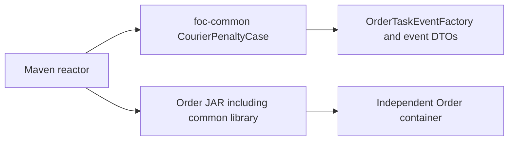

# CHANGE-130: Shared Maven penalty policy

Owner: Yao Xiang, order-service/penalty-integration, 2026-10-15.
Status: implemented and locally verified. User selects an ordinary monorepo
Maven module containing only penalty policy. Existing127/128/129 work retained.

Move CourierPenaltyCase to sg.edu.nus.foc.common.penalty in foc-common.
Keep accepted cancellation +2, overdue delivery +1, successful delivery -1.
Amounts stay positive; existing event types supply direction. No JSON, reason,
event ID, outbox, transaction, topic, database, frontend or authentication change.
ADR-041 remains the approved D1 penalty amendment; User consumer remains missing.

Root Maven aggregator/wrapper builds foc-common and Order (first consumer).
Retain service parents and coverage gates. Plain library JAR, no Spring runtime,
server, Git submodule or independent deployment. No sibling backend migrations.
Root-context Docker builds common with Order and bundles it in the application;
explicit COPY and allowlist .dockerignore exclude unrelated source/data/secrets.
Compose, CI and staging agree; production promotes the already-tested image.
Shared/root Maven changes conservatively select all Maven backends in CI.

Alternatives: Git submodule adds repository/pointer/auth operations; published
artifact adds registry/release operations; copied enums drift. The user selects
same-commit Maven source builds. Existing standalone peers remain unchanged.
Order verification uses root wrapper -pl order-service -am. No external latest
fetch: ordinary git pull retrieves source; rebuild/redeploy updates containers.

Verification: shared contract tests RED before enum extraction, then common tests
and existing seven-field Order event contracts. Full Order verify/unchanged gates;
isolated Git fixture tests for shared change selection; Compose/YAML/shell checks;
root-context Docker build and packaged-JAR inspection. No deployment/score calls.

## Completed verification

- RED: shared tests failed compilation because the common enum was absent.
  Initial sandbox wrapper access failed; authorized cache/JDK run produced the
  expected RED. Initial PowerShell test-list quoting was corrected before run.
- Shared-change regression RED selected no backends; GREEN selects both fixture
  Maven backends, excludes frontend/library, and preserves service-only selection.
- Focused reactor tests: common4 and Order20 pass. Full root wrapper verify:
  common4 + Order420 =424, zero failures/errors/skips. Existing coverage gates
  pass: common4/4 lines (no executable branch counter); Order2120/2231 lines,
  892/1114 branches. No Order gate/exclusion changed. Surefire logged its existing
  fork shutdown timeout after all420 tests; final reactor BUILD SUCCESS.
- Docker Desktop was initially stopped; started hidden for integration/build.
  Separate validation image foc-order-service:shared-penalty-policy-check built
  successfully from root. Network-disabled shell verifies runtime common JAR.
  Host packaged Order JAR includes BOOT-INF/lib/foc-common-0.0.1-SNAPSHOT.jar;
  old Order-domain enum class is absent. No application container was recreated.
- Base and HTTP-peer Compose config --quiet pass. Isolated Git fixture regression,
  Bash syntax, ShellCheck0.11.0 and actionlint1.7.12 pass. Lint containers mount
  the repository read-only with runtime networking disabled. AsyncAPI/schema/
  topic forwarding validation and git diff --check pass; wire unchanged.
- No sibling backend or authentication source changes. Existing frontend127/129
  edits retained; no new frontend work or repeat frontend tests for this extraction.
  No database/schema migration, secret, cloud publication, deployment or push.
- Evidence: ignored order-service/target/change130-{red,focused,verify,ci-red,
  ci-green,docker,shellcheck,actionlint}.log. Existing127/128/129 edits/records
  preserved. No broad staging/commit mixes those overlapping changes.
- Hosted CI and human review remain pending; User subscription/policy adoption
  remains FEEDBACK-014. Other backend suites are selected by hosted CI but were
  not rerun locally because their application code/builds are unchanged.
