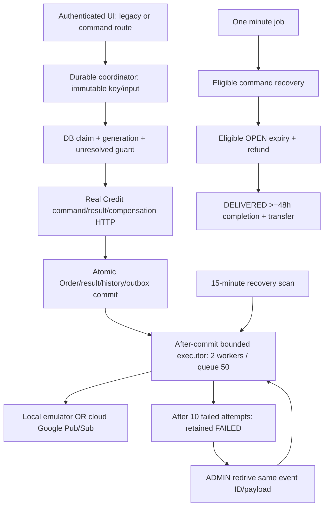
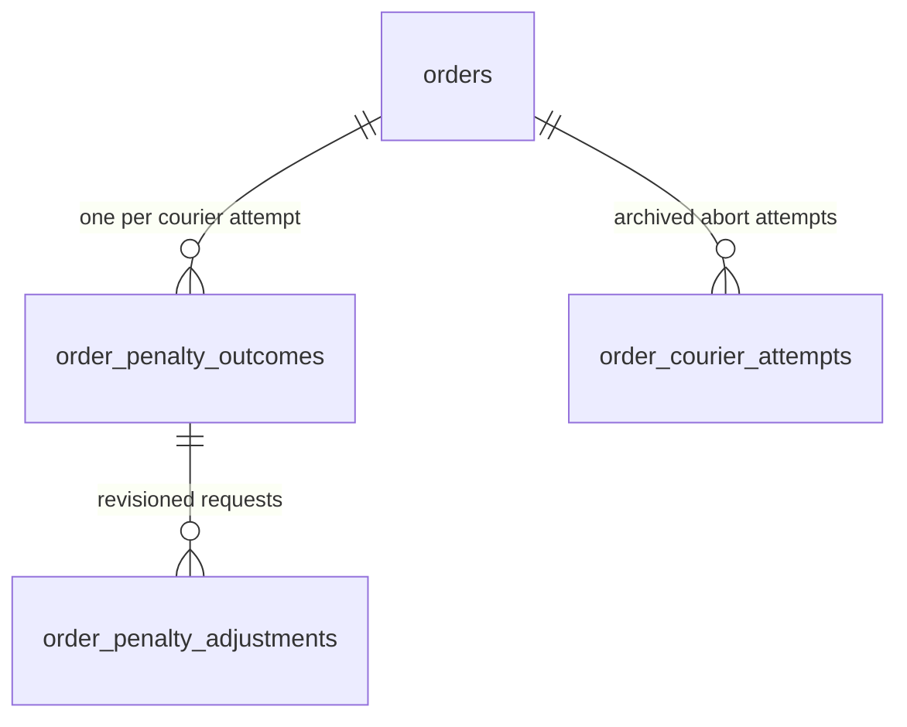

## Effective deferred-penalty amendment — CHANGE-146 / ADR-050 (2026-10-19)

## Effective retirement of accepted-cancellation publishing - CHANGE-155 / ADR-053 (2026-10-19)

User approved removing AcceptedOrderCancellationTaskEvent publishing AND legacy replay after inspecting staging: eight legacy rows were PUBLISHED, with no pending/failed rows shown. Preserve published history; this task does not modify any database or GCP resource. Production was not inspected: before rollout, verify no PENDING, IN_PROGRESS or FAILED legacy rows in each target database. Resolve any such rows explicitly before deployment; do not convert them into new score events or mark them PUBLISHED without broker confirmation.

Removed the legacy DTO, publisher/interface, factory/mapper methods, now-unused snapshot DTOs and dispatcher branch. The four current channels remain OpenOrderRefundTaskEvent, OrderCompletionTaskEvent, PenaltyScoreAdditionEvent and PenaltyScoreDeductionEvent. Courier abort still uses synchronous Credit hold/reopen and the existing final addition (plus refund when expired); no lifecycle, hold, penalty policy, idempotency or financial rules change. Historical database rows and immutable migrations remain intact. Other older refund/expiration normalization remains supported.

The retired topic setting is removed from Order config, deployment templates, local Compose/bootstrap, environment examples/staging/production settings, topic provisioning and CI topic checks. These scripts no longer require or create the old topic; they do not delete existing cloud topics or subscriptions. User Service consumes only the new scoring channels. Existing admin-provider authorization requests remain open. AsyncAPI1.3.0 describes four outgoing operations; earlier statements requiring accepted-cancellation replay/configuration are superseded by this amendment.

An unexpected non-published legacy row after deployment is unsupported and follows the existing bounded failure/recovery path, never automatic financial conversion. This is why the pre-deployment backlog check is required. Live User penalty processing, production backlog and cloud deletion are not verified here.


Approved Yao Xiang: remove penalty adjustment/replacement and the admin mark-completed API/UI. No synchronous User replacement call, setting, replacement topic, waiver or retroactive score modification exists in the current flow. User Service consumes only the existing final addition/deduction events. Requester and the auto-completion scheduler remain the completion actors.

Admin Apply penalty stores the highest report-case policy on the current assigned active Order, including held Orders. It cannot decrease/clear a stored penalty and emits no event or Credit/User penalty call. New POST /api/orders/admin/{orderId}/apply-penalty accepts {commandId, courierId, expectedVersion, policy, reason}; verified admin identity comes from the principal. NOWAIT locked transaction, pending-command guard and bound command receipt protect stale/concurrent/repeated calls. OrderResponse exposes appliedPenalty, derived appliedPenaltyAmount and actor/reason/time audit. Only report cases from getCourierPenaltyCases() are selectable. Terminal/unassigned/stale/wrong-courier requests409; invalid400; unauthorized401/403; missing404.

Requester/automatic completion chooses the highest stored report penalty or factual delivery overdue (1). If neither applies, it emits SUCCESSFUL_DELIVERY deduction (1); it never emits a reward plus a penalty. Previously persisted legacy waivers suppress only their overdue candidate; they cannot erase a stored report penalty, and no new waiver is allowed. Courier abort chooses max(stored policy, accepted cancellation2); archive retains stored policy/audit and reopening clears the current fields before another courier assignment. Admin cancellation chooses max(stored policy, explicitly selected policies) and never compares overdue; no stored/selected penalty means refund only. Existing initial outbox events and final per-attempt outcome recording remain atomic with the transition. Event wire schemas/topics are unchanged.

V14 adds Order and abort-archive policy/audit columns; V1-V13 and historical adjustment data remain untouched. Retired replacement records are historical only, with no runtime coordinator/gateway. No sibling backend, shared env/topic/CI/cloud changes. Report UI Open/Closed cards, required replies, no deadline and live Coming soon remain unchanged. Live Apply penalty uses the real Order API; local mode uses the isolated mock. Details and acceptance evidence: CHANGE-146/ADR-050.

## Effective penalty replacement and Report queue amendment — CHANGE-144 / ADR-049 (2026-10-18)

Approved Yao Xiang on order-service/penalty-integration: one current outcome per courier attempt, including No penalty or successful-delivery reward. Delivery stores factual overdue; completion/auto-completion read the stored flag. Initial outcomes are recorded atomically with completion/courier abort/admin resolution and existing event intents; original initial penalty/Credit topics and schemas are unchanged. A new acceptance has a new attempt identity, and an abort archive keeps the preceding identity.

Admin replacement is synchronous, not a new Pub/Sub topic. Order commits a stable-ID PENDING adjustment, calls User Service using fresh verified admin authorization, then confirms the current outcome in a second atomic transaction only after a matching reply. Another adjustment to that attempt is blocked while pending; exact same-ID authorized retry recovers timeouts/crashes. No bearer token is stored. User replacement endpoint is MISSING (FEEDBACK-016), so order.penalty-adjustment.enabled defaults false and live UI clearly disables writes. Local mock is isolated. Initial outbox publication never proves score application. New V13 tables preserve request audit/revision and current outcome; historical outcomes are not fabricated. Existing V1-V12 stay immutable.

Old overdue-waiver HTTP/UI is removed; V12 historical audit fields and previously saved decisions remain readable. Reports use Open/Closed cards with counts/pagination and visible five-second polling. No response deadline or deadline timer: courier may respond once while unresolved, and admin may resolve any open report with a required reply saved in resolutionNote. Case detail retains Order-first layout and links to separate Order financial actions. Report Service remains MISSING; HTTP-peer/staging/production Reports remain Coming soon. No sibling backend, shared environment/topic, CI or cloud configuration changes.


## Effective delivered-report review amendment — CHANGE-141 / ADR-048 (2026-10-18)

Approved Yao Xiang: new requester reports require own DELIVERED order; one damage/wrong-location category. Reports have AWAITING_COURIER_RESPONSE, READY_FOR_REVIEW and one RESOLVED final status. Courier response window is eight hours; server owns deadlines. Report Service is MISSING: the Report UI is a local-only isolated demo; HTTP-peer/staging/production show Coming soon and never fetch sample reports. Existing real Order financial actions remain separate from resolving a report.

Order stores deliveryOverdue at actual delivery, comparing deliveredAt against stored START plus duration deadline. isOverdue remains null before delivery or if historical timing is unknown; no runtime status refresh or new overdue scheduler. Admin waiver only before completion on DELIVERED late orders preserves the true lateness and saves actor/time/reason. Normal waived-late completion funds the courier but emits neither overdue addition nor successful-delivery reward. Explicit admin-selected penalties remain separate.

AdminOrderController adds PUT /api/orders/admin/{orderId}/completion-holds/{reportId}/release (no body) and POST /api/orders/admin/{orderId}/overdue-waiver ({reason}). Both verify admin role, use the verified principal, NOWAIT locked Order and the pending-command guard; all local writes are transactional. Release retains its report binding/audit and any other active holds. It may follow admin cancellation/completion and emits no funding event. Report Service must durably retry its release intent using forwarded admin Firebase authorization; no browser-only live orchestration exists. See FEEDBACK-015. V12 backfills only known delivery facts and adds waiver/release audit fields and an active-hold index; V1–V11 remain immutable.

Frontend uses existing theme/components, compact toolbar, darker selected rows and no redundant selection count. Normal/admin Reports poll every five seconds while visible; sample ownership, deadline and evidence checks are server-side in the gated prototype, which has no production identity authority or financial effects.

# Order Service Architecture

## Gated actual compensation transport - CHANGE-158 / ADR-055

The existing journal/outbox/result-inbox sequence now has an opt-in real Pub/Sub
request publisher and separately Google-OIDC-authenticated result receiver.
Credit owns reverse/fence/preimages/revisions and its transactional result outbox.
Persisted policy, not the current new-command default, selects each recovery path.
Local demo Auth/PubSub emulator gating is fail-closed; public gateway blocks the
exact receiver path. Default transport off/default retry/deployment unchanged.
No new schema, lifecycle states or automatic repost. Local verification evidence
and outstanding cloud provisioning/security rollout gates are in CHANGE-158.

## ADR-054 / CHANGE-156 - Opt-in compensation fixture architecture

`OrderCommandService` selects persisted-policy execution. For the new mock-only
policy, `OrderCompensationWorkflow` permits one initial gateway execution and
delegates uncertainty to `OrderCompensationJournal`. The latter locks the command,
fences its old worker and atomically saves a command-owned outbox message. Existing
outbox dispatch uses the fixture `CreditCompensationPublisher` boundary; a trusted
result fixture enters the journal's transactional inbox. No live push receiver
or Pub/Sub adapter is enabled. Existing Order transition services still own all
local business writes; success and terminal command result commit together.

V15 holds Credit step/final stage state separately; the original public command
status remains compatible. Current live ADR-035 behavior is unchanged by default;
new `compensate` selection with HTTP peers fails closed before mutation. Sequence,
schema, safe-clear requirement and readiness gates are in the
[handoff](../concurrency/compensation-workflow-handoff.md). FEEDBACK-017 blocks live.

## Compact calendar toolbar — CHANGE-139

CHANGE-139, user-directed2026-10-17: Admin Orders toolbar is a compact41px desktop table-top row, with existing RefreshCwIcon-only refresh and two native calendar-icon date fields (DD/MM/YYYY to DD/MM/YYYY), no visible Created-from label. Wrap on mobile; keep existing Order-ID/status search and financial dialogs/navigation. Creation-date bounds are local calendar days converted to explicit instants (start inclusive, day after end exclusive). Refresh retains filters and clears stale selection. Additive admin list filters execute in SQL before sorting/count/pagination; samples filter only isolated fixtures. No schema/financial/event/peer/config change. See changes/CHANGE-139-compact-admin-toolbar-date-filter.md.


## Current admin resolution UI — CHANGE-138

CHANGE-138 / ADR-047 (Yao Xiang,2026-10-17): Admin Orders now support single-row selection, shaded state, a top Cancel/Complete action bar and shared full-detail actions. The dialog requires an explicit penalty/no-penalty choice and a preset/custom explanation. Backend policy discovery supplies amounts; only the highest addition is selected. Optional resolutionReason is normalized, persisted atomically in V11 and bound into new receipts; absent/null preserves legacy fingerprints. OrderResponse exposes saved admin decision/time/explanation. Existing auth, active-state/held override, participant locks, credit/penalty events and ordinary hold guards remain. Mock mode mutates sample memory only; live mode calls existing protected endpoints without fallback. No sibling backend, root config or cloud change.


CHANGE-137 / ADR-046, approved Yao Xiang2026-10-17: AdminOrderController adds
POST /api/orders/admin/{orderId}/complete. Assigned ACCEPTED/IN_PROGRESS/PICKED_UP/
DELIVERED may become COMPLETED, including held Orders. Stored participant IDs must
match. Publish existing Credit completion event plus at most one highest selected
penalty addition; null/empty means WAIVED, no automatic overdue penalty or reward.
Locked atomic decision/checkpoint/receipt/outbox and bound ADMIN_COMPLETE replay;
hold history and actual timing preserved, no fabricated delivery. Ordinary hold
guards remain. Reuses V10 columns/topics; no migration, UI, peer or cloud change.
HTTP200 confirms local intents, not Credit settlement or User score application.


CHANGE-136 (Yao Xiang, 2026-10-17): AdminOrderController now owns both GET
/api/orders and POST /api/orders/admin/{orderId}/cancel. The separate cancellation
controller is removed; paths, roles, validation, transaction service and event
contracts are unchanged. OrderResponse imports Schema normally; JsonProperty
retains isCompletionHold/isOverdue and Schema documents nullable timing.


CHANGE-135 / ADR-045 (Yao Xiang, 2026-10-17) supersedes the earlier overdue
reader: persist deliveryDeadlineAt at courier START plus delivery duration and
deliveredAt at delivery. isOverdue is a nullable timestamp comparison, without
checkpoint queries or a flag-refresh scheduler. Actual delivery freezes lateness;
adminResolutionAt freezes undelivered admin cancellations. Unstarted/unknown
legacy/historical timing stays null. Completion uses those same persisted facts.
V10 adds these timing fields and admin decision/reason/amount/resolution time;
WAIVED and ADDITION_REQUESTED record intent, never subscriber APPLIED. Ordinary
holds still block completion and courier abort; explicit admin cancellation may
resolve held Orders. UI score feedback/callbacks remain deferred. Existing event
payloads/topics/authentication and sibling backends are unchanged. See CHANGE-135.


CHANGE-134 / ADR-044 (Yao Xiang2026-10-16): POST /api/orders/admin/{orderId}/cancel
accepts requesterId, nullable courierId and optional appliedPenalties. Admin-only;
all active/held states -> CANCELLED; locked stored participants, maximum one
addition, no successful reward; refund and optional penalty commit in outbox.
Common adds COURIER_UNRESPONSIVE=3. OrderResponse nullable isOverdue is calculated
from persisted START deadline/delivery timing under CHANGE-135. Existing
roles/topics/schedulers unchanged; Report/User integration remains pending.

CHANGE-132 renames the common type to PenaltySystemPolicy and adds static reward,
report-subset and full-list queries. Order completion and event direction use
the reward helper; event DTO/facts types use the renamed enum. Names/amounts/JSON
and lifecycle behaviour remain unchanged. The subset excludes the original3;
returned lists are immutable. No authentication/peer/build/schema changes.

CHANGE-131 completes shared D1 penalty data with three confirmed-report reasons
(4/4/10). No new Order flow selects them; only accepted abort, overdue completion
and successful completion continue to publish. Report resolution/suspension and
highest-incident aggregation remain future work; current wire schema unchanged.

ADR-043 / CHANGE-130 moves only PenaltySystemPolicy to foc-common's
sg.edu.nus.foc.common.penalty package. OrderTaskEventFactory and penalty DTOs
import the shared enum. Same signed policy/positive event amount, stable enum
names and wire JSON. Root Maven builds the library before the independent Order
application image. No auth, persistence, state, API or runtime-service change.

ADR-042 / CHANGE-129 adds a read-only involvement service/domain projection,
use-case repository ports, native EXISTS adapter queries and separate mapped
User/Supplier response DTOs. All three roles may query booleans; no foreign
lookup, entity mutation, paging, name persistence, row lock or schema change.
Held active Orders count. Deletion admission/race policy remains peer work.
Companion existing supplier-name hook uses deleted labels for missing data,
preserves real names and uses unavailable labels on failure; no layout changes.
ADR-041 / CHANGE-128 centralizes amounts in PenaltySystemPolicy (+2/+1/-1).
Typed addition/deduction DTOs, publisher/interface pairs and one internal facts
DTO/MapStruct mapping use existing outbox infrastructure. New aborts replace
accepted-cancellation publication; legacy replay stays. Completion atomically
queues Credit transfer plus exactly one courier penalty. Holds/rollback/replay
create no new penalty. User subscriber and clamp ordering remain peer work.

ADR-040 / CHANGE-127 adds requester-authorized placement of per-report holds on
active Orders, plus persisted completion_hold and ordinary response isCompletionHold.
Held completion, expiry, cancellation and accepted-abort funding paths produce
no final outcome. Hold records/flag are transactional under the same Order lock;
insert-only report keys prevent cross-Order rebind races. Query filtering and
locked rechecks preserve independent scheduler jobs. Release and the actual
Report client remain deferred. Detailed components/sequence/data: ADR-040.

CHANGE-122 adds frontend request-time adminApiMode to distinguish base Compose
samples from HTTP-peer local integration. Override disables existing Order demo
routes through their current flag; Order peer HTTP mode and security are retained.
No backend class/contract/schema change. Existing119 real adapter/capabilities are
reused; cloud/invalid config stay live. Effective selector diagram: ADR-039.

CHANGE-119 adds no backend component. Runtime config selects local mock transport
or real matching APIs in the Admin adapter. Capability flags prevent unfinished
User/Credit calls; selected user uses the existing limited summary. Order related
labels load independently, retaining ID navigation during peer delays/failures.
Existing repositories/schedulers/outbox/security and peer services are unchanged.
Current component/sequence diagrams and handoff are in ADR-039/admin-peer-api-request.

CHANGE-114 adds no Order backend component: frontend maps use existing sample
supplier coordinates and create payload; Order detail grouping uses existing
responses, preserving all returned fields. Public map reads are isolated from
authenticated mock service reads/writes. Backend repositories/jobs unchanged.

CHANGE-113 is frontend-only: AdminOrderDetails and AdminSupplierDetails render
dedicated pages, using existing Order-owned sample reads. Existing Order query
filters by exact ID before paging; adapter uses page1/size1 and rejects absent/
mismatched records. Backend controllers/store/persistence are unchanged.

CHANGE-112 refines ADR-039: selected-record routes independently load sample
profiles/locations; AdminUserProfile shares TransactionHistoryView presentation
with normal Profile, but uses the Order mock history loader. Existing normal
GET /credits/me/transactions and all lifecycle/outbox logic are unchanged.
The sample store owns fixture transaction pages; no Credit database access.

ADR-039 / CHANGE-111: AdminMockController -> synchronized AdminMockService ->
MapStruct response copies, requiring explicit local emulator configuration.
Shared frontend admin pages -> semantic adapter -> sample HTTP routes.
Domain persistence/recovery/lifecycle unchanged. ADR-039 contains class/sequence
diagrams; admin-peer-api-request.md records the real-provider stopping point.

ADR-038 / CHANGE-108 adds an owner-only CommandView display projection and a
shared frontend discovery provider. ACCEPT/ABORT show actual committed target
details; CREATE/REPOST show immutable submitted details without fake Orders.
Owned command checks precede projection, including after acceptance deadline.
General Order read policy, provider APIs, data model and financial flow unchanged.
Effective display class/sequence: decisions/ADR-038-server-discovered-pending-card-recovery.md.

CHANGE-107 / ARCH-EVO-043 retires the unused expiry HTTP adapter only. The minute
job still invokes recovery -> expiry -> completion directly; lifecycle workers,
locks, transactions and refund publication are unchanged. All repost adapters stay.

Effective ADR-037 adds durable manual REPOST to the same coordinator. V8 separates
original guard from candidate reservation. OrderRepostService.manualConfirmed finalizes without
remote I/O; link/new OPEN/checkpoint/receipt/result commit together. Exact current
class/sequence/data design: decisions/ADR-037-durable-manual-repost.md. Automatic
repost remains deferred; no peer/topic/config changes.

## Effective review refinements — CHANGE-105 / ADR-036

Legacy CREATE/ACCEPT/ABORT -> OrderCommandService; no direct Credit/local-commit
bypass. Existing coordinator validates, leases and guards before remote I/O;
final Order/history/outbox/result remain atomic. Read policy checks relationships.
V7 receipts add actor_id/input_fingerprint (SHA-256, length-prefixed fields);
historical rows remain unbound, so replay conflicts rather than guesses.



V6 outbox state includes FAILED; payload/ID preserved, explicit redrive resets
attempts/lease/due time. No consumer completion inferred from PUBLISHED.
Local Credit's approved security exception affects only two typed push routes;
ordinary JWT verification and cloud Google OIDC remain. Cloud Order min1/always
CPU enables timers while idle; no external shared-token lifecycle trigger needed.
Automatic repost/delegation and User penalty subscribers remain deferred.

## Effective HTTP command gateway — CHANGE-104 / ADR-035

OrderCommandController → OrderCommandService → leased OrderCommandStore → HttpCreditCommandGateway → Credit command/result/compensation API → atomic local finalizer. LocalCreditCommandStub is selected only in explicit mock mode. Matching saved results and mutation markers are mandatory; uncertain responses retain PENDING. Bounded peer timeouts apply. The minute job still runs recovery → expiry → completion; tokenless HTTP recovery asks for fresh user authorization before peer I/O. No lifecycle/data-model change. Historical mock-only descriptions below are superseded at this adapter boundary.

## Foreground durable command stub — CHANGE-100 / ADR-033

Latest approved CREATE/ACCEPT/CANCEL_ACCEPTED refinement: commit immutable intent
and candidate/target before Credit I/O; claim with a DB-clock lease/generation;
use a durable unresolved target guard plus existing row locks; atomically commit
Order/history/receipt/outbox and terminal command result. Owner-only status reads
are not new-task eligibility checks; mutation/resume still revalidates eligibility.
Five-second UI polling, frozen account-scoped IndexedDB intent and auth-only
Continue controls accompany this slice. ADR-034 / CHANGE-102 merges the mock-only
command scan into the minute lifecycle job: recovery -> expiry -> completion.
The HTTP gate, item transactions/guards, outbox schedule and repost behavior
remain unchanged; lifecycle time is captured after recovery.

The [class responsibilities, service sequence, minimal peer contracts and V5
data model](../concurrency/concurrency-order-credit.md) are the effective feature
design. Historical diagrams apply except these explicitly amended unsafe-call
boundaries. HTTP recovery remains hard disabled; Credit protocol is a documented
stub assumption, not verified financial durability. FEEDBACK-010 extends 003/006.

## Order personal filters and five-second polling — CHANGE-094 / ADR-032 (2026-10-09)

Yao Xiang explicitly requests five-second Order UI polling, Abort errand wording, and status filters on My Errands/My Requests. The existing /api/orders/mine adds optional status; default all, invalid status 400, existing identity/mode checks and page envelope retained. Database filters before page/count, preserving ABORTED courier attempts and hidden successfully reposted requester originals. Existing Base UI filters/pagination reset page 1 and cancel stale reads. Order-only polling is5 seconds; Credit/generic default 15 seconds; auth/visibility/no-overlap/focus/mutation protections retained. No scheduler, event, peer, schema or background-retry change. Verification and limits: CHANGE-094. Historical Order interval descriptions are superseded only by this approved amendment.

## Lifecycle per-order failure isolation — CHANGE-093 (2026-10-09)

Yao Xiang explicitly requests failed scheduled tasks be skipped while later successes continue. Due selection returns IDs filtered in the DB (latest delivery cutoff for completion), without locking a whole batch. Nontransactional lifecycle coordinator calls fresh NOWAIT-locking per-order transactions (expiry worker / existing autoComplete with REQUIRES_NEW), catches each RuntimeException including commit failures, logs order ID, counts only successful transitions, then continues. Scheduler retains independent whole-pass catches. Failed orders remain eligible next normal lifecycle pass; no new repost retry mechanism or cron/contract/schema/peer change. Previous batch transaction description is superseded by this refinement; CHANGE-092 compact payloads and FEEDBACK-009 remain unchanged.


## Effective compact-event amendment — CHANGE-092 / ADR-031 (2026-10-09)

Yao Xiang approved the exact seven-field Order-only payload: eventId, eventType, orderId, orderStatus, creditAmount, occurredAt, courierId. This replaces full snapshots and overdue facts ONLY for OpenOrderRefundTaskEvent and OrderCompletionTaskEvent. AcceptedOrderCancellationTaskEvent retains its existing v1 envelope/snapshot. Internal outbox versions and Pub/Sub eventVersion attribute remain (compact schema v2); topic names and DB schema unchanged. Old pending snapshot rows normalize at dispatch from their saved facts, with stable IDs. Lifecycle/outbox scheduling, locks, synchronous Credit assignment/reset and ADR-025 abort behavior remain. Historical v1 descriptions below are superseded for these two bodies. Credit currently requires the old snapshot and overdue; FEEDBACK-009 is INCOMPLETE_OR_INCOMPATIBLE. User completion penalties need an agreed separate overdue source. User approved implementing Order-only and documenting peer work; live integration remains blocked, Sprint [~].


## Effective validation refinement - CHANGE-091 / ADR-030

Order.open/createManualRepost own local field/minimum validation. New RepostPlan
constructor requires expiry >= scheduled due+30min; due>=original expiry remains.
JPA hydration and late automatic execution preserve saved explicit plans. Manual
submission requires expiry>=submission+30min, without applying that minimum to
automatic execution. Existing ErrorResponse details identify actual fields; UI
maps them inline, backend remains authoritative. Creation verifies requester,
validates local fields, then Supplier/Credit, before persistence. No responsibility,
peer/topology/event/schema/credential/retry change; dated timing below is history.


CHANGE-088 / ADR-029 adds an opt-in [local live test topology](local-live-testing.md)
only: real HTTP peers, existing authenticated Order profile, isolated real Pub/Sub,
restricted HTTPS push into local Credit. No class/domain/state/migration changes.
Actual cloud/ledger verification remains pending; paused retry/delegation retained.

## Effective CHANGE-086 refinement

Explicit automatic new expiry and latest safe repost failures are Order-owned
fields, not a retry task or an additional aggregate. RepostPlan validates
expiry > due >= original expiry; execution uses that saved future deadline.
OrderRepostService invokes Supplier/Credit synchronously and rolls back failed
business attempts. AFTER_ROLLBACK invokes RepostFailureRecorder through its
Spring proxy: a new locked transaction saves only code/message/time on the
still-EXPIRED unlinked original. Domain rules prevent older callbacks overwriting
newer outcomes; success clears the outcome. No domain-to-peer calls introduced.
V4 disables legacy plans with no explicit deadline, by Vincent's decision.
HTTP auth remains unchanged; background retries and credentials remain paused.
The earlier unimplemented descriptions below are historical; CHANGE-086 and
the effective diagram own current expiry/outcome status.


## Effective current workstream

CHANGE-084 / ADR-027: approved durable same-ID temporary retries until new expiry,
terminal failure EXPIRED-card messages and authenticated HTTP polling. These are
target responsibilities, not implemented worker/schema/API/UI. Trusted peer
authorization is proposal/documentation ONLY; implementation explicitly deferred.
No new source classes, persistence schema, endpoint or security mechanism added.

CHANGE-083 / ADR-026 supersedes historical timer cadence/settings: one shared
minute lifecycle job and 15-minute recovery with immediate dispatch retained.
Approved target and current gaps: docs/diagrams/order-lifecycle-reconciliation.md.
Explicit automatic expiry and durable repost retry/UI state are not implemented.

CHANGE-082 / ADR-025 implements the user-selected overall PDF with approved lifecycle overrides. Editable class/sequence/data responsibilities are in `sprints/sprint-2-3/README.md`; the historical Updated PDF named below is absent locally. Order now has an internal UUID primary key plus a unique business ID and immutable courier-attempt snapshots. No peer service writes Order storage, and domain classes still do not invoke external ports.

Authoritative sources: `../../../Order Service Overall Doc - Updated.pdf`, `../../../High Level Architecture Diagram - Order Service.png`, and `../../../Class Diagram - Order Service.png`. The updated overall design informed Sequences 5-7 and typed event contracts; CHANGE-056 supersedes its separate overdue completion flow. Standalone diagrams remain separately fingerprinted artifacts.

## Layers and ports

1. External callers: requester, courier, Admin Service, and trusted lifecycle triggers.
2. Inbound contracts: commands, queries, admin integration and retained repost triggers. Expiry and scheduled completion use direct in-process scheduler calls, not an expiry HTTP API (CHANGE-107).
3. Application components: creation, assignment, transitions, queries/history, completion-time overdue evaluation, scheduled auto-completion, expiry, and reposting.
4. Order-owned domain rules: lifecycle/status, authorization, checkpoints/history, one-time overdue evaluation, and repost policy.
5. Outbound ports: Order persistence/outbox, User/Supplier/Credit and typed outcome publishers. Acceptance waits for synchronous Credit assignment before ACCEPTED (provider missing). The shared OrderLifecycleScheduler discovers OPEN expiry and >=48h delivery completion, using existing lifecycle/transition services to queue the respective refund/completion intents.
6. Messaging infrastructure: transactional outbox, immediate after-commit relay, 15-minute recovery and typed Google PubSub publishers. Same project/separate dev/prod topics; personal read-only ADC locally, attached Cloud Run identity in production, topic-scoped IAM. The shared lifecycle job triggers expiry/completion; peer subscriptions are future work and are not awaited by Order.

Order Service owns only Order data: status, assignment, checkpoints, flags, supplier references, and repost links.

## Approved persistence and deployment

By ADR-008, Order Service persists in PostgreSQL on one Cloud SQL instance in `asia-southeast1`,
with separate `order_staging` and `order_production` databases. Cloud Run is the deployment target;
the runtime connects through the public-IP Cloud SQL Java Connector. Database passwords remain in
Secret Manager. This is an Order Service-specific approved deviation from the parent repository's
Firestore convention; it does not change sibling-service persistence.

## Control and data flow

- Inbound contracts dispatch the selected command, query, or lifecycle use case to an application component.
- Application components ask Order-owned domain rules to validate and decide. Domain rules return decision, status, flag, and checkpoint data to the application layer.
- Application components invoke `OrderRepository`, User/Supplier/Credit service ports, and typed event publishers. Domain rules do not call repository, broker, or external-service ports directly.
- Completion, open cancellation, and expired accepted cancellation commit the resulting Order state, checkpoint, command receipt, and typed event in one PostgreSQL transaction. An `AFTER_COMMIT` listener immediately attempts Pub/Sub publication; a Spring cron poller retries due outbox entries. Publish failures do not roll back the committed transition. Delivery is at least once; stable event IDs let consumers deduplicate. Completion always publishes `OrderCompletionTaskEvent`, which carries `overdue` and `overdueAt` for User/Credit policy.
- Order Service does not wait for Credit or User subscriber responses. Consumer delivery, deduplication, retries, and dead-letter recovery belong to future peer work and are not verified by this Order-only change.

This direction keeps domain rules independent of persistence and peer-service integration while application components own orchestration.

## Overall class responsibilities

- `OrderCommandInterface` and `OrderCommandFacade` route creation, acceptance, transitions, cancellation, and repost commands.
- `OrderQueryInterface`/`OrderQueryService` provide available, current, account, and checkpoint/history views as their sprint scope permits.
- CHANGE-057 adds an admin-only all-orders query through `AdminOrderController` -> `OrderQueryService` -> `OrderRepository` -> persistence adapter; the controller never accesses JPA directly.
- `LifecycleTrigger`/`LifecycleProcessingService` handle expiry, auto-completion, and automatic repost processing when in scope.
- ADR-026 uses OrderLifecycleScheduler -> LifecycleProcessingService -> OrderRepository due-delivery selection -> OrderTransitionService.autoComplete; the transition shares normal completion/checkpoint/overdue/receipt/outbox behavior. The other pass expires due OPEN orders and queues refunds.
- Specialized application services handle creation, assignment, transitions, administration, and reposting.
- `OrderRepository` is the only Order persistence abstraction.
- `UserServicePort`, `SupplierServicePort`, and `CreditServicePort` isolate synchronous external calls. Credit reservation and unexpired accepted-cancellation `holdForReopen` remain synchronous; Order waits for hold confirmation before reopening. Completion, cancellation, and OPEN-refund consequences otherwise use typed events.
- Credit `assignCourier` is also synchronous: `OrderAssignmentService` validates before the call, waits for the proposed matching reservation confirmation, then rechecks expiry before acceptance. The Order mock and HTTP adapter do not verify that Credit provides the route.
- `OrderTransitionService` and `LifecycleProcessingService` create the shared `OpenOrderRefundTaskEvent` through `OrderTaskEventFactory` for requester-cancelled and scheduler-expired OPEN orders; `OrderOutboxDispatcher` routes it through one refund publisher (and retains a compatibility route for already-persisted legacy outbox rows).
- The shared minute lifecycle job also selects DELIVERED orders with delivery checkpoints at least 48 hours old using PostgreSQL locks. The transition rechecks latest-delivery eligibility under lock and reuses the requester completion event/outbox path.
- `OrderTransitionService` records the post-transition event through `OrderEventOutboxRepository` in the same transaction as the Order, checkpoint, and command receipt. `OrderOutboxAfterCommitListener` requests immediate delivery before the transactional service call returns; `OrderOutboxScheduler` invokes the recovery dispatcher on its configured cron. `OrderOutboxDispatcher` claims rows with leases, calls the typed publisher, and records success or bounded-backoff retry state.
- Matching publishers retain the existing three typed topics. Credit consumes shared refunds and completion transfers. User consumes accepted-cancellation penalty facts for EVERY abort and all completion facts. Legacy ABORTED cancellation-event refunds need coordinated replay/reconciliation; new expired aborts emit a separate shared refund. Neither subscriber writes Order data.
- Every ACCEPTED-only abort first resets Credit synchronously, then saves immutable ABORTED history and current OPEN/EXPIRED under the same business ID. It always queues User penalty, plus Credit refund only when expired. ADR-025 supersedes the prior ADR-001/014 behavior for this slice. Current Order, history, checkpoints, receipt and outbox commit atomically; the external Credit reset does not share that transaction.

The diagrams are logical architecture, not permission to implement future-sprint operations.

## Updated design reconciliation

The updated overall design supersedes the previous generic outcome/synchronous consequence description for Sequences 5-7. CHANGE-063/ADR-013 supersedes the publish-first ordering in CHANGE-053 with a transactional outbox, after-commit fast path, and cron recovery. CHANGE-067/ADR-016 defines event snapshots as the current Order/repost fields without checkpoint history; overdue facts remain derived internally. CHANGE-073/ADR-021 uses real Google Cloud Pub/Sub in all environments, one project with separate topics, personal local ADC, and the Cloud Run service identity. Delivery is at least once; Cloud Run scale-to-zero/request-based CPU limits cron recovery while idle.


## Quarter-hour UI and scheduler cadence (ADR-022)

The shared frontend QuarterHourDateTimePicker owns local date/hour/quarter-minute presentation; orders helpers own rounding and client validation; Post Request/RepostControls coordinate the existing authenticated API calls. Order application/domain layers retain API validation and authoritative deadlines. No backend class dependencies or data-model fields change.

Historical ADR-022/023 cadence is superseded by ADR-026: OrderLifecycleScheduler
checks expiry and completion every minute; OrderOutboxScheduler recovers all
pending/failed event kinds every 15 minutes. Immediate dispatch and repository
cutoff/locking are unchanged. Failed publication can wait for the next quarter-hour
recovery pass; Cloud Run idle/scale-to-zero can delay it further.


## CHANGE-079 / ADR-024: Central role annotations (approved 2026-10-08)

Production Firebase validation resolves User Service roles once per request, verifies response identity against JWT subject, and enforces RequireRequesterRole/RequireCourierRole/RequireAdminRole. Order-specific production role mode defaults to HTTP; local anonymous/mock behavior remains. Adapters reuse verified roles/identity, retaining fresh courier eligibility and locked domain ownership/state guards before mutation. Shared reads accept any confirmed requester/courier/admin role; /mine uses its selected mode. Internal lifecycle/scheduler authorization, API bodies, event payloads and schema remain unchanged. See ADR-024 for endpoint policy, inspected peer contracts and positive/negative test obligations.

## Scheduler DB selection and independent outbox dispatch — CHANGE-096 (2026-10-10)

The active lifecycle paths retain CHANGE-093: DB-filtered IDs, separate REQUIRES_NEW expiry/completion workers, fresh NOWAIT locks and outside-proxy catch. Outbox recovery now selects bounded eligible event IDs in SQL (due PENDING or expired IN_PROGRESS lease), then individually claims/rechecks with SKIP LOCKED. Claim, markPublished and scheduleRetry use separate REQUIRES_NEW transactions; enqueue remains REQUIRED with Order/checkpoint/receipt. Dispatcher catches each event's claim/commit/retry-write errors, logs its ID and continues later events. A failed retry write leaves the committed lease recoverable after expiry. Neither scheduler nor batch coordinator is transactional. Pub/Sub publication stays outside DB transactions and is irreversible; stable-ID deduplication remains required. Legacy claimDue is retained for compatibility, unused by the active scheduler. No cadence, schema, event body, peer, frontend or paused repost change.

## Swagger current-origin server — CHANGE-098 (2026-10-10)

CHANGE-098 sets an explicit relative OpenAPI server / through OpenApiConfiguration. Swagger now resolves API calls against the origin serving the specification, retaining /api/orders paths and Firebase authorization. Live staging docs previously advertised an HTTP backend host despite HTTPS gateway UI. This is an Order-only documentation routing implementation detail; no gateway, peer, CORS allowlist, forwarded-header trust, schema, frontend or deployment-env change. Tests first: one expected server-URL failure and one existing documentation pass (target/change098-red.log). Fresh source-only wrapper-selected Maven3.9.16/Java21 offline verify:253 tests,0 failures/errors/skips, including28 PostgreSQL tests; coverage96.00% lines (1441/1501),83.72% branches (468/559), unchanged >=80% gates pass. Generated target/openapi.json servers=[{url:"/",description:"Current gateway or service origin"}];160 current POM/source/test/resource files equal the fresh tested copy. Logs/reports target/change098-verify.log and target/change098-source-check/target/, evidence target/change098-evidence.json. git diff --check passes. No local application container rebuild or real authenticated browser request; no commit/push/cloud deployment. Staging remains unchanged until Order Service redeployment.

### Synchronous replacement sequence (CHANGE-144)
```mermaid
sequenceDiagram
    Admin->>Order: Replace attempt outcome (commandId, revision, policy, reason)
    Order->>OrderDB: Lock Order; commit PENDING request
    Order->>User: PUT replacement (stable requestId, snapshots, admin token)
    User->>UserDB: Idempotently replace contribution and save confirmation
    User-->>Order: Confirm requestId / penaltyId / revision / policy / amount
    Order->>OrderDB: Lock Order; confirm request and current outcome atomically
    Order-->>Admin: Confirmed outcome
    Note over Order,User: Timeout or local failure: pending survives; same-ID retry, no new adjustment topic
```

### Penalty persistence (V13)


Order.courierAssignmentId is created at acceptance; the abort archive and outcome share it. PenaltyOutcomeRecorder joins the original transition transaction. PenaltyAdjustmentWork prepares and confirms in separate REQUIRES_NEW transactions with the existing NOWAIT Order lock; AdminPenaltyAdjustmentService orchestrates outside a DB transaction; HttpUserPenaltyAdjustmentGateway owns the synchronous wire call; PenaltyOutcomeMapper owns DTO conversion. No Pub/Sub publisher exists for adjustments.

### Current deferred penalty sequence — CHANGE-146
```mermaid
sequenceDiagram
    Admin->>Order: Apply report policy (courier, version, commandId, reason)
    Order->>DB: NOWAIT lock; store maximum policy/audit + bound receipt
    Order-->>Admin: OrderResponse (no score event)
    Requester or Scheduler->>Order: Complete eligible delivered Order
    Order->>DB: Lock; choose max(stored policy, stored overdue)
    Order->>DB: Commit COMPLETED, receipt, checkpoint, Credit outbox and one score outcome
    Order->>PubSub: After-commit dispatch/recovery
    PubSub-->>User: Existing addition OR deduction event
```

Admin cancellation separately selects max(stored, explicit selected policy) and never overdue; refund and optional addition commit together. No admin-completion or penalty-adjustment sequence remains. Historical V13 adjustment table is inactive audit data. Current mutable policy belongs to orders/current courier assignment; immutable abort archive copies it, and final order_penalty_outcomes records the emitted result.


## Effective CHANGE-147 — Report reply privacy and active policy choices (2026-10-19)

Approved Yao Xiang: admin resolution reply is visible only to the submitter and reviewing admins; courier participants still see resolved status/time and other existing case information. Local prototype list/detail responses redact resolutionNote on copied snapshots, and UI hides the reply in courier views. Production Report Service is still missing and must enforce this with verified caller identity, never client-supplied roles. Live Reports remain Coming soon.

COURIER_UNRESPONSIVE is retired from active policy lists and new admin apply/cancel choices. Its enum/amount remain only for historical persisted rows and existing outbox events; immutable migrations and saved penalties are not rewritten or waived. Six active policies; three selectable report penalties (wrong location4, damage4, theft10). Cancellation UI selects one radio case and sends the existing one-element list; stored maximum semantics and existing penalty topics remain unchanged.

Report cards omit Order descriptions; closed cards are muted but remain navigable. Requester/courier names link to admin profiles, IDs have separate copy rows. Admin table names, email, roles and IDs truncate visually while full values remain in titles/copy/details. No sibling backend or shared runtime/CI/cloud configuration changes. See CHANGE-147.


## Effective CHANGE-153 — Hold eligibility and paused funding (2026-10-19)

Yao Xiang approved placing a requester-owned completion hold on any Order status except COMPLETED. This supersedes delivered-only placement and the old blanket terminal-state rejection for new holds. Preserve status, ownership/role checks, bound report IDs, locked transaction and release history. A hold placed after cancellation/expiry records a hold only; it does not restore lifecycle state or reverse settled funding.

The user explicitly clarified that ordinary cancellation, expiry and courier abort (and their refunds/penalties) must remain paused, in addition to requester/automatic completion. START, PICKUP and DELIVER continue normally; acceptance keeps its existing behavior. Admin cancellation remains the previously approved explicit override. Auto-completion and expiry retain held-row SQL exclusion. Report mock submission fixtures remain delivered-item samples; this change broadens the real Order hold endpoint, not a production Report Service implementation.

No schema, event/topic, frontend, shared configuration or sibling backend change. This is eligibility validation only. See CHANGE-153 and ADR-052.
