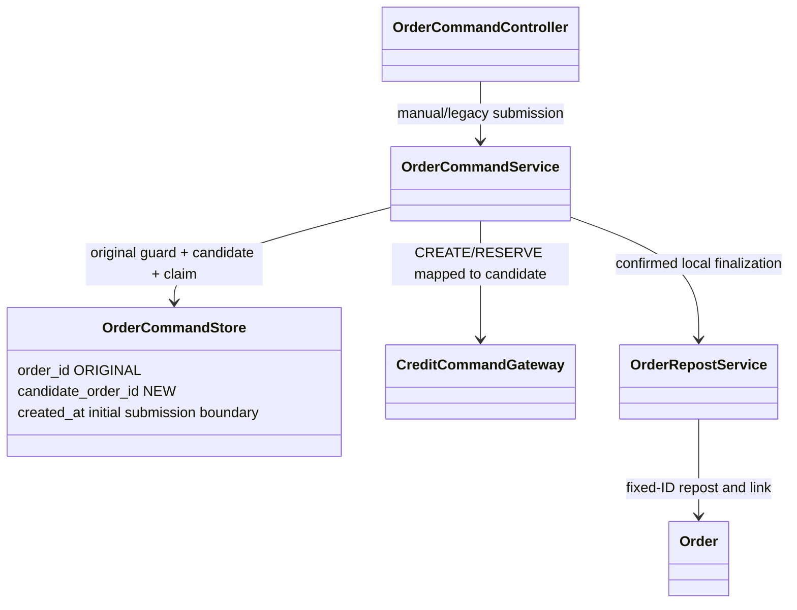

# ADR-037: Durable manual repost with original and candidate identity

- Status: APPROVED, implemented/automated verified; consuming rollout pending.
- Approver/date: Vincent, explicit V8 and route approval, 2026-10-11.
- CHANGE-106 / ARCH-EVO-042; current Vincent branch unchanged.
- Supersedes manual-repost deferral only in ADR-027/033/035/036. Automatic
  repost and trusted delegation remain deferred. Historical records preserved.

## Decision and trade-offs

Extend the existing coordinator rather than keep an unsafe legacy repost path.
Order commits one immutable REPOST command before Credit I/O. V8 permits REPOST,
retains order_id as ORIGINAL guard target and adds candidate_order_id as the
distinct NEW reservation/successor UUID. Existing command rows remain unchanged.
Lease/generation and unique pending original arbitrate requests and recovery.
The extra identity/schema complexity is necessary: guarding the candidate alone
would allow multiple successors for one original.

POST /api/orders/commands/{originalId}/repost accepts ManualRepostRequest;
202 PENDING / 200 COMPLETED CommandView. Legacy /{id}/repost delegates to it:
successful Order JSON, pending202, terminal rejection error. One key binds actor,
original/version, edited description/amount/duration/expiry and frozen suppliers.

REPOST maps to existing Credit RESERVE with candidate ID, only requesterId/amount
and existing authentication/key/generation headers. No peer contract changes.
Initial minimum expiry is submission+30min; recovery requires that same saved
expiry still future, not a sliding minimum. Conditional compensation/fencing
must resolve invalid possible effects before terminal rejection.

Success commits successor OPEN/checkpoint/receipt, original link and command
result atomically. Only then hide the expired original. Confirmed rejection saves
the latest safe original failure; unknown outcomes stay pending. IndexedDB keeps
account-scoped frozen key/input through reload. Disable inputs/action until
terminal; Continue only when authorization is required. No saved tokens.

## Class / sequence / data design

```mermaid
sequenceDiagram
  participant UI as RepostControls/useOrderCommand
  participant C as OrderCommandService
  participant DB as Order PostgreSQL
  participant F as OrderRepostService
  participant Credit as Credit command API
  UI->>C: REPOST K + original/version + edited fields + user token
  C->>DB: Lock original; commit immutable PENDING and candidate B
  C->>DB: Claim owner/lease/generation; validate; commit possible_effect
  C->>Credit: Lookup K; if missing reserve B, requesterId + amount
  alt Confirmed effect, still eligible
    C->>F: Finalize B under claim/original locks
    F->>DB: Successor OPEN + original link + receipt/checkpoint
    C->>DB: COMPLETED SUCCESS in same transaction
  else Invalid possible effect
    C->>Credit: Conditional compensate K, no body
    C->>DB: After confirmation, failure + COMPLETED REJECTED
  else Unknown or authorization missing
    C->>DB: Keep PENDING; release claim; retry/auth reason
  end
  UI->>C: Poll owned status; fresh-token Continue only if needed
```



## Verification and rollout

TDD and exact evidence live in CHANGE-106. Test clean and V7->V8 preservation,
original guards, concurrent claims, stable candidate, real Credit replay/rollback/
compensation and pending UI. Apply reviewed V8 through normal Flyway startup;
never edit V1-V7, reset data or drop unresolved evidence. Rollback disables workers
and preserves commands for reconciliation; use a forward corrective migration.
Human consuming migration review/browser/cloud gates remain separate.

Final automated evidence:367 backend tests,90 frontend tests; line94.76%/
branch80.23%. Includes actual Credit manual timeout/rollback/rejection/reversal.
Local consuming rebuild was blocked by Docker engine500; no local V8 rollout or
all-peer manual smoke claim. Source commit2c021b6; strict/Sprint status remains[~].
