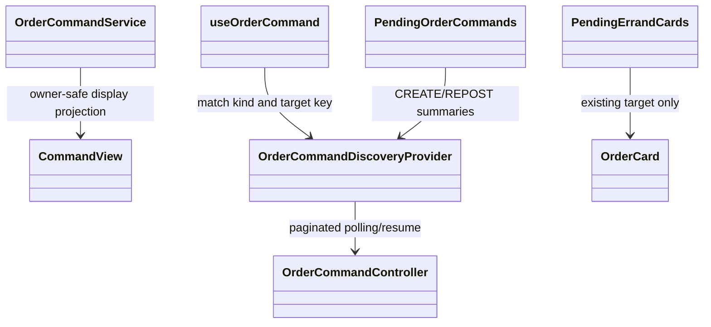

# ADR-038: Server-discovered pending card recovery

- APPROVED by Vincent, 2026-10-11; CHANGE-108 / ARCH-EVO-044.
- Supersedes only ADR-033/035/037's local-only card intent restoration and separate
  accept/abort labels. Preserve all command/financial/authentication rules.

## Contract and ownership

Owned CommandView adds nullable displayDetails: itemDescription,
pickupSupplierId, deliverySupplierId, offeredCredits, deliveryTimeLimitMinutes,
expiresAt, plus nullable orderStatus/version for existing ACCEPT/ABORT targets.
CREATE/REPOST use saved immutable inputs, not fabricated Order records. Target
Order supplies ACCEPT/ABORT current committed details only after command ownership
verification. A missing target returns null. Terminal results retain ordinary
result semantics. No raw input payload, credentials, worker/lease/hash/diagnostics
or unrelated user data. No general Order-read permission change, new peer I/O,
Credit/event payload or schema change.

## UI responsibilities

Shared page/account discovery loads every pending page through existing API and
polls every five seconds while visible. Cache resets immediately on identity
change; failed reads retain known pending actions. Local intent still protects a
not-yet-recorded submission. Match ACCEPT/ABORT/REPOST by kind + target orderId.
My Errands can display a real existing OPEN pending-acceptance target even before
assignment, without implying success. Render it once, never attach a command to
immutable ABORTED history, and keep pending tasks discoverable outside filters.
Cards remain in their committed status; disable competing actions and show
Pending/Continue. Resume sends existing key and current token only.
CREATE/REPOST stay submitted-detail summaries without fake candidate Order cards;
original EXPIRED repost card remains, and another repost action is disabled.
No new global policy preventing independent creation commands is introduced.

On list disappearance, fetch the known key's terminal result before clearing;
do not infer success from pagination/list absence. Remote-only missing-key reads
remain unresolved; never invent or replay a new submission body/key. Confirmed
terminal outcome refreshes Order lists and displays success/rejection. Existing
local frozen-intent same-key resubmission remains unchanged.

Terminal display cleanup deletes only a browser intent whose saved key matches
the confirmed server command, in one IndexedDB readwrite transaction, before
refreshing/unmounting its card. Never erase a newer independent action in that
scope. Browser storage being absent/unavailable does not reverse a confirmed
server result. Immutable history does not mount a live action hook at all.

```mermaid
sequenceDiagram
  participant UI as Shared discovery and card hooks
  participant C as Order command API
  participant DB as Order commands and Orders
  UI->>C: GET owned pending pages + current user token
  C->>DB: Owned commands + safe target/input projection
  C-->>UI: Keys, reasons and displayDetails
  UI->>UI: Attach existing targets / show creation-repost summaries
  opt Authorization required
    UI->>C: POST same K/resume + fresh token (no body)
  end
  opt Known K disappears from pending list
    UI->>C: GET owned K terminal result
    C-->>UI: Confirmed result or unresolved
    UI->>UI: Clear only confirmed terminal; refresh normal Order lists
  end
```



Tests: ownership/data minimization/missing target, cleared IndexedDB restoration,
same-key resume, terminal disappearance, errors/account changes, pagination,
history/dedup/filter behavior and responsive frontend. Existing integration and
financial regressions remain. Options and trade-offs: CHANGE-108 proposal history.
