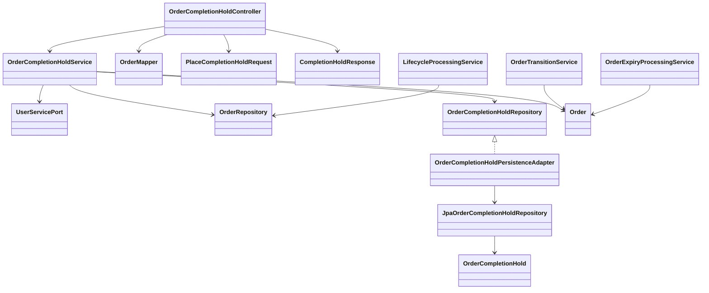

# ADR-040: Requester report completion holds

Effective exception2026-10-16: ADR-044 permits admin cancellation of active
held Orders as report resolution. It retains the hold flag/placement history.
Requester/courier/scheduler guards and deferred generic release remain unchanged.


Status: approved Order-side placement/guard milestone, Yao Xiang, 2026-10-14.
Related: CHANGE-127, Project D1 NTH2 PDF38/NTH3 PDF41, ADR-013/026/034/036.

## Decision and scope

The user chooses forwarded requester Firebase authorization and ownership of an
active Order, with funding frozen during investigation. Only the requester can
place this hold; courier penalty-report eligibility belongs to future Report
Service work. Release is explicitly deferred. This implements an Order-side
contract, not Report submission, investigation, penalty policy or resolution.

Hold placement keeps the status unchanged. The boolean is not a new OrderStatus.
Active statuses are OPEN, ACCEPTED, IN_PROGRESS, PICKED_UP and DELIVERED; terminal
Orders reject new holds so committed settlements cannot be undone by a report.

## Contract and authorization

PUT /api/orders/internal/{orderId}/completion-holds/{reportId}, body:

```json
{"requesterId":"forwarded-Firebase-UID"}
```

Production applies RequireRequesterRole and UserServicePort.verifyRequester,
reusing the request's validated JWT/roles and comparing UID with the body. The
locked Order then checks ownership. The internal path name is not authentication;
a requester can call this API directly. It does not prove Report Service identity
or verify that the absent Report Service has created the supplied report ID.
Local behavior retains the existing profile/mock/emulator security split.

Report Service must keep a stable report ID, forward the requester's token and
wait for200 before claiming the hold is active. On timeout it retries the same
IDs. Report-side durable retry and submission/hold reconciliation need actual
implementation; FEEDBACK-013 remains OPEN/MISSING for that caller.

Return200 with orderId, reportId, isCompletionHold and the committed Order version.
Ordinary Order responses expose isCompletionHold too. Traditional DTOs and
MapStruct mappings retain the established API conventions. Invalid payload is400;
authentication/role/ownership failures401/403; missing Order404; terminal status,
pending command or incompatible report binding409; unavailable role provider503.
There is no release endpoint. DELETE on the placement path is not implemented.

## Persistence, concurrency and guards

V9 adds orders.completion_hold, non-null/default false, and order_completion_holds
(report_id primary key, order_id foreign key, requester_id, placed_at), with an
Order lookup index. Existing data/migration history is retained. Records contain
identifiers only, not allegations or evidence.

Placement locks the same Order row used by lifecycle commands, verifies the
requester/status, checks the immutable report binding, inserts the placement and
sets the flag in one transaction. Report IDs cannot move between Orders. Same-
Order retries serialize under the row lock and return the existing hold without
extra writes. Different-Order collisions use an insert-only database write and
the unique report key; they return409 and roll back the losing Order's flag.
JPA merge/upsert is unsuitable because it can overwrite a previously committed
binding after another request already read the ID as absent.

Held Orders reject requester completion before receipt/checkpoint/outbox writes.
Ownership is checked before revealing the hold. For the owner, the report message
precedes version validation, because placement itself increments the version and
a stale browser must still receive the useful report explanation.

Auto-completion and OPEN expiry exclude held rows in their database ID queries,
then recheck after locking. Held/busy/failed jobs do not block other eligible
Orders. Existing per-item REQUIRES_NEW transactions and post-commit publication
remain. Domain guards also block OPEN cancellation and accepted courier abort
before their Credit operation or resulting refund/penalty event intents. A
requester report does not prevent a courier from attempting abort, so courier
ownership alone cannot enforce the funding freeze.

Hold writes create no lifecycle checkpoint, command receipt, Credit/User call or
broker event. Existing published event schemas/topics remain unchanged. Already
committed events are not retractable; new terminal Orders cannot acquire holds.
The existing unresolved-command guard prevents placement racing a pending
cross-service mutation; Report must retry rather than claim a failed hold succeeded.

## Flow and components

```mermaid
sequenceDiagram
    actor Requester
    participant Report as Future Report Service
    participant API as OrderCompletionHoldController
    participant Hold as OrderCompletionHoldService
    participant DB as Order PostgreSQL
    Requester->>Report: Submit report for own active Order
    Report->>API: PUT hold with stable report ID and requester token
    API->>API: Existing Firebase/Requester role chain
    API->>Hold: Verified placement request
    Hold->>DB: Lock Order; verify owner/status and report binding
    Hold->>DB: Insert report placement and set flag in one transaction
    DB-->>Hold: Commit
    Hold-->>Report: 200 isCompletionHold=true, committed version
    Note over Report,DB: No Order status or final credit action from report submission
    Note over API,DB: Held completion/expiry/refund paths produce no outcome event
```



## Frontend and future release

Requester DELIVERED cards display the ongoing-report explanation and disable
Confirm completion when the flag is true. A stale cached flag still receives the
backend's409 report message through the existing toast handling. No Report UI or
other service is implemented here.

Holds persist in this milestone. Future release/resolution must reconcile all
reports under the same Order lock and preserve report-ID replay safety; it cannot
clear another report's hold. Releasing a DELIVERED Order that is already due can
immediately expose it to the scheduler, so the agreed administrative outcome and
release must not race. No release or administrative settlement contract is selected
by this ADR. Enable Report-side use only after all active Order revisions contain
these guards; an old revision does not enforce the new flag.

Tests cover owner/role/token contracts, no release, terminal states, stale browser,
funding guards, immutable binding races, rollback, query/lock rechecks and isolated
successes. Verification results and local migration handoff are in CHANGE-127.
