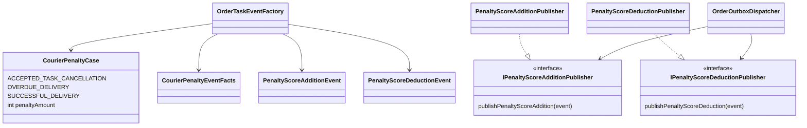
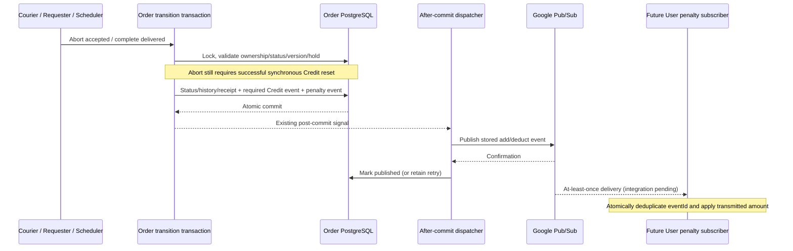

# ADR-041: Explicit courier penalty additions and deductions

Placement amendment, 2026-10-15: ADR-043 / CHANGE-130 moves the enum to the
ordinary foc-common Maven library. References below to Order owning the enum
describe the original placement; approved values and event behavior remain.

Status: approved by Yao Xiang2026-10-14 on order-service/penalty-integration.
Topic-only shared configuration also explicitly approved in chat. Configure
staging dev-v1, production prod-v1 and local private local-v1 topics; existing
topic provisioning/infra-check scripts include both. No cloud execution here.
CHANGE-128. Effective amendment to ADR-025/031 and User penalty handoff.

Order owns enum mapping: ACCEPTED_TASK_CANCELLATION +2, OVERDUE_DELIVERY +1,
SUCCESSFUL_DELIVERY -1. Positive penaltyAmount and typed addition/deduction event
carry direction. User approval changes the existing successful deduction of2
to1. User Service consumes transmitted amount; existing hardcoded HTTP outcome
functions are not the consumer contract. No peer implementation changed.

Use courier-penalty-addition-dev-v1 and courier-penalty-deduction-dev-v1, with
matching prod names. Exact seven JSON fields: eventId, eventType, orderId,
courierId, penaltyAmount, occurredAt, appliedReason. Capture abort courier before
clearing assignment; completion uses assigned courier, not requester/lifecycle.
The existing delivered-versus-acceptance-deadline calculation selects the reason;
48-hour requester/system confirmation delay does not itself make delivery overdue.

New successful abort emits penalty addition instead of accepted cancellation.
Existing Credit completion/refund messages stay unchanged. Legacy DTO/publisher/
dispatcher remain for already-stored accepted events; do not rewrite them into
new-ID penalty events. Consumer cutover must avoid scoring both outcome and
explicit penalty topics. Actual consumer is MISSING (FEEDBACK-014), not verified.

Both funding and penalty outbox rows commit atomically with Order/receipt.
After-commit dispatch and scheduled retry/redrive use the stored payload/ID.
Identity includes event type, bound command, Order, target courier and reason:
abort and completion may legitimately reuse a string command ID across operation
names. Adding reason avoids their addition events colliding. No public payload
version fields; existing internal outbox metadata/attributes remain.

Holds, failed validation, failed Credit reset, rollback and command replay enqueue
no additional penalty. A failed publish does not roll back committed completion;
outbox retries independently. No synchronous User scoring or distributed atomic
score update. Existing database schema supports these event types; no migration.

Two topics do not guarantee cross-topic order. User's clamping makes arithmetic
order-sensitive. Consumer must choose arrival-order semantics or deterministic
ledger/recomputation; this Order publisher does not claim ordering/exactly-once.
User must atomically deduplicate eventId with score update, authenticate delivery,
and provision separate environment subscriptions. Cloud provisioning is separate.

