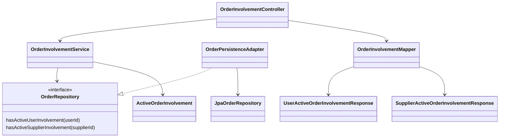
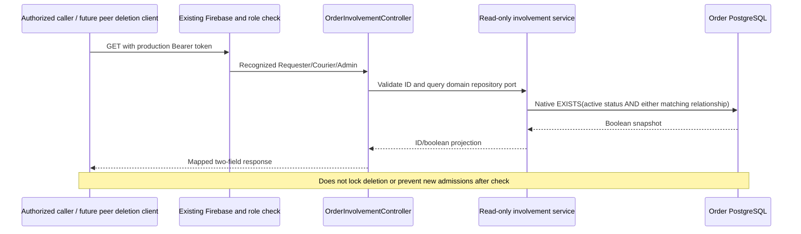

# ADR-042: Shared-role active involvement queries and deleted labels

Approved by Yao Xiang2026-10-14, CHANGE-129, order-service/penalty-integration.
User changes initial admin-only proposal to Requester/Courier/Admin shared reads.

## Decision

GET /api/orders/users/{userId}/active-involvement -> userId/hasActiveOrders.
GET /api/orders/suppliers/{supplierId}/active-involvement -> supplierId/hasActiveOrders.
Production uses existing Firebase and RequireOrderRole; any of the three roles
may query another ID's boolean. No names, Order details or deletion permission
returned. Local split unchanged. No body, paging, foreign existence request,
command receipt, locking or mutation. Invalid IDs400; anonymous401; other roles403;
role dependency503. No matching Order returns false, including unknown IDs.

Native SQL EXISTS matches five active statuses: OPEN, ACCEPTED, IN_PROGRESS,
PICKED_UP, DELIVERED. User matches current requester/courier; Supplier matches
pickup/delivery. Held active Orders count; past expiry timestamp does not itself
change OPEN to EXPIRED. Terminal Orders and historical courier attempts do not
count. Application depends on domain port, infrastructure owns query/SQL status
binding; no fetch-all/in-memory search or new schema/index required.

Traditional separate API DTOs, Lombok and explicit MapStruct map a domain read
projection. Both methods return only two fields, with hasActiveOrders a boolean.

## Deletion is not implemented here

Actual User DELETE removes User; Supplier DELETE soft-deactivates. Neither calls
Order now. FEEDBACK-015 requires owner integration and fail-closed handling of
unavailable checks. The caller must still authorize deletion and validate its
own entity. hasActiveOrders is not canDelete: check/delete can race new admissions.
Unresolved CREATE/other durable commands and unpaid/unpublished terminal outcomes
are outside this active-row predicate. Complete deletion safety needs an agreed
cross-service deactivating/admission/reconciliation policy; no such protocol is
silently invented or claimed by this read-only milestone.

## UI/reference handling

Names stay dynamic frontend lookup data, never Order fields. User declines new
people rows; keep current card layout. Supplier lookup returns records/missingIds
including inactive records. Missing/omitted/null successful results display
Deleted supplier; existing names remain, including soft-inactive records.
Network/auth/server errors keep Location unavailable and do not hide Orders.
This branch has no User-name lookup/display on Order cards; do not add storage,
invent an Admin layout or treat temporary errors as deletion. Future User-name
consumers should use a deleted label only for confirmed absence/404, not failures.

