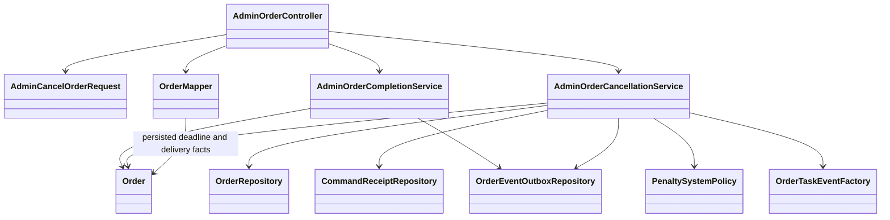

# ADR-044: Admin cancellation and authoritative overdue observation

Timing/decision-storage amendment, 2026-10-17: [ADR-045](ADR-045-start-based-persisted-delivery-timing.md) supersedes the acceptance-based grouped reader.
START deadline and delivery timestamps plus admin decision are persisted by V10.
Other cancellation/auth/event decisions below remain effective.


Status: approved by Yao Xiang2026-10-16, current penalty-integration branch.
Implementation/verification: CHANGE-134. D1 NTH1 administrator oversight, NTH2
highest selected penalty and NTH3 report resolution; user adds unresponsive3.

## Decision

POST /api/orders/admin/{orderId}/cancel requires existing admin role verification.
Body: requesterId, nullable courierId, nullable appliedPenalties policy-name list.
Validate participant assertions against the locked Order; never take the penalty
recipient from unverified input. Allow OPEN, ACCEPTED, IN_PROGRESS, PICKED_UP and
DELIVERED, including held Orders. Reject terminal states and unresolved commands.

Admin cancellation is a specific exception to ADR-040's held funding freeze:
cancel as a resolution, retain hold flag/placement history on the terminal Order.
It does not release other reports or add a release endpoint. Courier/requester
cancellation and scheduler guards remain unchanged.

Null/empty penalties mean refund only. All policy addition cases are allowed;
SUCCESSFUL_DELIVERY and null elements reject. Without a courier, additions reject.
Select one maximum amount (ties use enum declaration order), not a sum. Shared
policy adds COURIER_UNRESPONSIVE=3, full set7; other names/amounts stay unchanged.
Do not claim highest-effective reconciliation across prior events or suspension
enforcement: User/Report must implement those consumer-side requirements.

## Consistency and delivery

Existing no-wait write lock and pending-command guard coordinate mutations.
An endpoint-scoped advice maps translated lock contention to409/retry guidance,
without changing error behavior of existing commands.
One transaction writes CANCELLED state, checkpoint, bound receipt, refund and
optional addition outbox rows. Derive a per-order ADMIN_CANCEL key, bind canonical
participants/reasons and authenticated admin; exact replay returns committed
result, changed replay409. Concurrent/lifecycle calls cannot overwrite cancellation.

Preserve courierId on the Order/refund to match Credit's reservation assignment.
Reuse OpenOrderRefundTaskEvent and penalty-addition topic. No synchronous Credit
call is required: Credit's current consumer accepts CANCELLED with matching
assignment. Existing after-commit dispatch/retry/stable event IDs apply. The200
response confirms local intent commit, not completed financial/score processing.

## Overdue read

OrderResponse adds nullable isOverdue. Use latest acceptance plus delivery limit;
actual delivery freezes the result, cancellation freezes an undelivered result,
otherwise use current time while active. Strictly after deadline=true. Unassigned,
historical courier attempt or insufficient timing=null. Missing data is not on-time.
One grouped bounded SQL query supplies checkpoint timestamps per result page;
no fetch-all history scan or query-per-item. No new persisted field/migration.
Existing MapStruct mapper handles base DTO mapping plus batched enrichment.

Report uses existing authorized GET /api/orders/{id}; it must retain current
admin/participant credentials and treat null as unknown. No new service identity
or read bypass. Nullable additions fit inspected frontend JSON handling; exact
external validators must update. The Admin detail fallback may display the flag.

## Tests and operational boundaries

Class diagram updated by CHANGE-135/136 for persisted timing and consolidated
AdminOrderController ownership. Historical business decisions remain unchanged.



Verify roles/body validation, active/terminal/held cases, highest/tie/reward/null,
identity mismatch, exact replay, real transaction rollback on second intent,
no-wait lock contention, grouped timing SQL and overdue deadline boundaries.
Source/query/API changes are Order/Common only; frontend gets an optional nullable
type. No Admin UI control, Report/User implementation, topic, secret, deployment
or production database operation. User subscriber remains FEEDBACK-014 pending.

```mermaid
sequenceDiagram
    actor Admin
    participant API as Admin cancellation API
    participant App as Cancellation transaction
    participant DB as Order PostgreSQL
    participant Outbox as After-commit dispatcher
    participant PubSub as Google Pub/Sub
    Admin->>API: POST orderId + participant IDs + penalties
    API->>API: Existing Firebase and ADMIN verification
    API->>App: Authenticated admin identity + request
    App->>DB: Lock Order NOWAIT; guard unresolved commands
    App->>App: Check receipt, participants and active state
    App->>App: Select highest addition (or none)
    App->>DB: CANCELLED + checkpoint + receipt + event intents
    DB-->>App: Atomic commit
    App-->>API: Committed Order response
    API-->>Admin: 200 + nullable isOverdue
    App-->>Outbox: Existing AFTER_COMMIT signal
    Outbox->>PubSub: Stored refund + optional penalty addition
    Note over Outbox,PubSub: Stable IDs; retry on failure; consumers deduplicate
```
