# Order event publisher classes

CHANGE-130 / ADR-043: PenaltySystemPolicy belongs to the foc-common Maven JAR,
package sg.edu.nus.foc.common.penalty. Factory/DTO associations below refer to
that shared enum; all transport, factory and publisher classes stay Order-owned.

Effective CHANGE-128/ADR-041. Per-event publishers/interfaces remain in
messagingpublisher/publisher and messagingpublisher/interfaces. Traditional
DTOs and MapStruct use one internal facts input. Credit DTOs remain unchanged;
legacy accepted publisher is only for already-stored outbox replay.

```mermaid
classDiagram
    class PenaltySystemPolicy {
        ACCEPTED_TASK_CANCELLATION
        OVERDUE_DELIVERY
        SUCCESSFUL_DELIVERY
        WRONG_LOCATION_DELIVERY
        ITEM_MISHANDLING_OR_DAMAGE
        DELIBERATE_ITEM_RETENTION_OR_THEFT
        +getSuccessfulDeliveryReward() PenaltySystemPolicy
        +getCourierPenaltyCases() List~PenaltySystemPolicy~
        +getFullPenaltyPolicy() List~PenaltySystemPolicy~
        int penaltyAmount
    }
    class CourierPenaltyEventFacts
    class OrderTaskEventFactory
    class OrderTaskEventMapper
    class OrderOutboxDispatcher
    class OrderTaskEvent {
        <<interface>>
    }
    class IEventPublisher {
        <<interface>>
        publish(topicId, event)
    }
    class GoogleCloudPubSubEventPublisher
    class GoogleCloudPubSubPublisherFactory
    OrderTaskEventFactory --> PenaltySystemPolicy
    OrderTaskEventFactory --> CourierPenaltyEventFacts
    OrderTaskEventFactory --> OrderTaskEventMapper
    GoogleCloudPubSubEventPublisher ..|> IEventPublisher
    GoogleCloudPubSubEventPublisher --> GoogleCloudPubSubPublisherFactory
    class IPenaltyScoreAdditionPublisher {
        <<interface>>
        publishPenaltyScoreAddition(event)
    }
    class PenaltyScoreAdditionPublisher
    class PenaltyScoreAdditionEvent
    PenaltyScoreAdditionPublisher ..|> IPenaltyScoreAdditionPublisher
    PenaltyScoreAdditionPublisher --> IEventPublisher
    PenaltyScoreAdditionEvent ..|> OrderTaskEvent
    OrderOutboxDispatcher --> IPenaltyScoreAdditionPublisher
    OrderTaskEventMapper --> PenaltyScoreAdditionEvent
    class IPenaltyScoreDeductionPublisher {
        <<interface>>
        publishPenaltyScoreDeduction(event)
    }
    class PenaltyScoreDeductionPublisher
    class PenaltyScoreDeductionEvent
    PenaltyScoreDeductionPublisher ..|> IPenaltyScoreDeductionPublisher
    PenaltyScoreDeductionPublisher --> IEventPublisher
    PenaltyScoreDeductionEvent ..|> OrderTaskEvent
    OrderOutboxDispatcher --> IPenaltyScoreDeductionPublisher
    OrderTaskEventMapper --> PenaltyScoreDeductionEvent
    class IOrderCompletionTaskPublisher {
        <<interface>>
        publishOrderCompletionTask(event)
    }
    class OrderCompletionTaskPublisher
    class OrderCompletionTaskEvent
    OrderCompletionTaskPublisher ..|> IOrderCompletionTaskPublisher
    OrderCompletionTaskPublisher --> IEventPublisher
    OrderCompletionTaskEvent ..|> OrderTaskEvent
    OrderOutboxDispatcher --> IOrderCompletionTaskPublisher
    OrderTaskEventMapper --> OrderCompletionTaskEvent
    class IOpenOrderRefundTaskPublisher {
        <<interface>>
        publishOpenOrderRefundTask(event)
    }
    class OpenOrderRefundTaskPublisher
    class OpenOrderRefundTaskEvent
    OpenOrderRefundTaskPublisher ..|> IOpenOrderRefundTaskPublisher
    OpenOrderRefundTaskPublisher --> IEventPublisher
    OpenOrderRefundTaskEvent ..|> OrderTaskEvent
    OrderOutboxDispatcher --> IOpenOrderRefundTaskPublisher
    OrderTaskEventMapper --> OpenOrderRefundTaskEvent
    class IAcceptedOrderCancellationTaskPublisher {
        <<interface>>
        publishAcceptedOrderCancellationTask(event)
    }
    class AcceptedOrderCancellationTaskPublisher
    class AcceptedOrderCancellationTaskEvent
    AcceptedOrderCancellationTaskPublisher ..|> IAcceptedOrderCancellationTaskPublisher
    AcceptedOrderCancellationTaskPublisher --> IEventPublisher
    AcceptedOrderCancellationTaskEvent ..|> OrderTaskEvent
    OrderOutboxDispatcher --> IAcceptedOrderCancellationTaskPublisher
    OrderTaskEventMapper --> AcceptedOrderCancellationTaskEvent
```

Amounts2/1/1 are positive; event type chooses add/deduct. Penalty JSON contains
eventId, eventType, orderId, courierId, penaltyAmount, occurredAt, appliedReason.
Operational versions are JsonIgnore. Facts are mapping-only, never published.

State/receipt and required Credit/penalty intents commit together; signals run
after commit. Dispatcher publishes stored events outside Order transactions and
independently marks success/retry. Stable IDs and payload survive redelivery.
User subscriber/ordering and cloud resources are not verified by this diagram.
