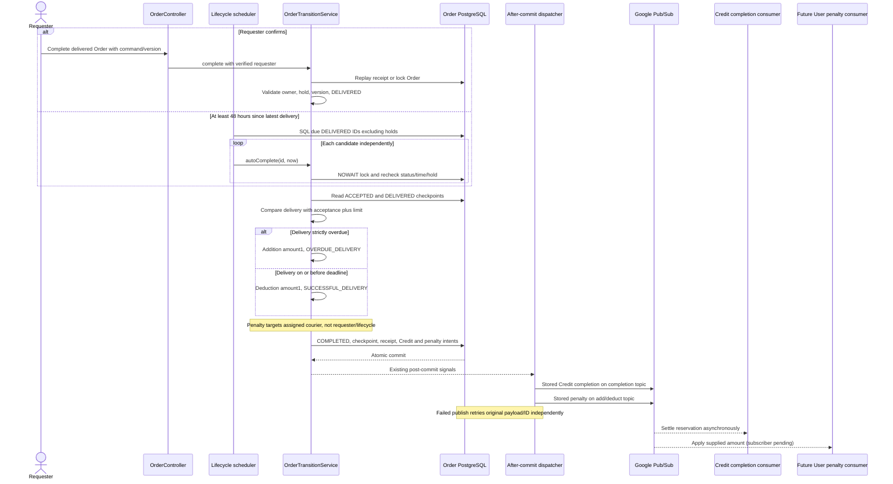

# Sequence 5: Complete an order

Effective CHANGE-128/ADR-041 and CHANGE-127/ADR-040. Credit compact completion
remains unchanged; User receives a separate explicit penalty decision.

Exactly one Credit and one penalty event per successful completion. Penalty has
eventId/eventType/orderId/courierId/penaltyAmount/occurredAt/appliedReason;
versions stay in outbox/attributes. The48-hour confirmation delay is not overdue
delivery. Held requester completion rejects409; held automatic work skips.
Rollback/receipt replay create no new penalty. At-least-once transport requires
atomic User deduplication/score update. Subscriber/cutover/clamp ordering are
FEEDBACK-014, not verified. Class/sequence responsibilities: ADR-041.
